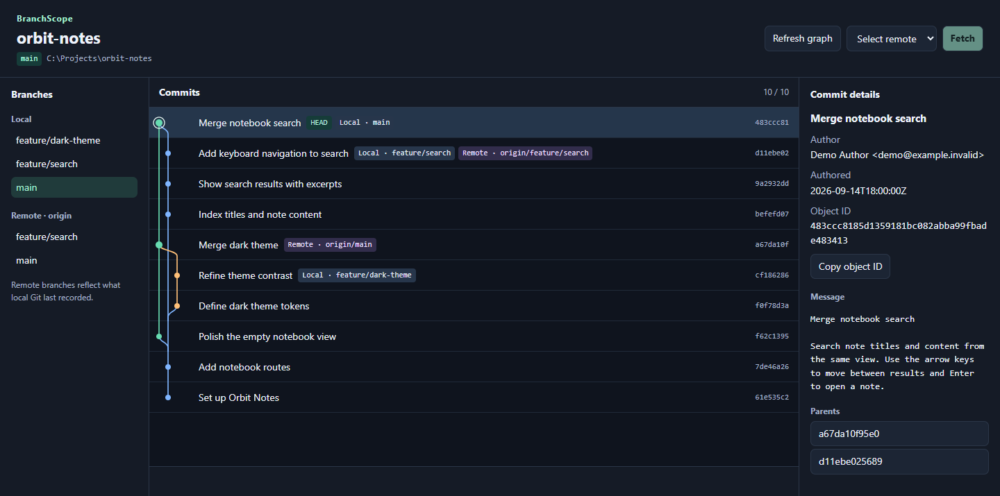

# BranchScope

BranchScope is a local Git history viewer for Codex Desktop on Windows. Follow branches through forks and merges, see where branch tips point, and inspect commits beside your project chat. You can also open the same graph in a browser without Codex.



*The example checkout shows local and remote-tracking branches, two merges, and the selected commit’s parents.*

## Requirements

- Windows, Node.js 20 or newer, and Git for Windows 2.45 or newer. Make `node` and `git.exe` available on `PATH`.
- For the Codex panel, use Codex Desktop with experimental MCP Apps support and make `codex.exe` available on `PATH`. The standalone browser viewer needs Node.js and Git.

BranchScope runs from a Git checkout with no npm packages to install.

## Get started

Clone BranchScope from PowerShell and enter its directory.

```powershell
git clone https://github.com/Millik42/CodexBranchScope.git
cd CodexBranchScope
```

### Open the panel in Codex Desktop

1. Run the local plugin installer from the BranchScope checkout.

   ```powershell
   node src/install-panel.mjs
   ```

2. Start a new local chat in the Git project whose history you want to view.
3. In the right panel, choose **+ → More tools → Plugins and MCPs → BranchScope**. Open it in each chat where you want the graph. To use an inline card, ask Codex to open BranchScope in the chat.
4. Check the repository, checkout path, and branch shown at the top. To switch checkouts, or if the panel cannot detect your project directory, select **Open checkout…**, enter an absolute path on a local drive, and select **Open**.

The installer copies the plugin to `%LOCALAPPDATA%\BranchScope\marketplace`, registers it in your local Codex profile, and enables the experimental `enable_mcp_apps` feature. The [verification notes](docs/verification.md) record the Codex versions exercised and the remaining manual checks.

### Open the graph in a browser

From the BranchScope checkout, run the launcher with the path to the repository or linked worktree you want to view. Omit the path to view the current checkout.

```powershell
node src/open.mjs "D:\work\my-project"
```

Open the full URL printed in the terminal in your regular browser or the Codex built-in browser. Keep the launcher running while you use the graph. Press `Ctrl+C` to stop it. The server also stops after 20 minutes without a graph request.

BranchScope includes an **Open BranchScope** project action in [its Codex environment configuration](.codex/environments/environment.toml). Run the action from the BranchScope project and open the printed URL in the built-in browser. To add the action to another Codex project, use absolute paths to the launcher and that project's checkout in its `.codex/environments/environment.toml`.

```toml
[[actions]]
name = "Open BranchScope"
icon = "run"
command = 'node "D:\tools\CodexBranchScope\src\open.mjs" "D:\work\my-project"'
```

## Use the graph

- Select a local or remote-tracking branch to jump to its tip, even when the commit is outside the loaded history. Remote-tracking branches are grouped by remote and show the latest state recorded in your local Git refs.
- Follow the colored lines to trace commit parents and merges. The graph starts with up to 200 commits in topological order. Scroll to load older history or select **Load older commits** when it appears.
- Select a commit to see its full message, author, authored date, object ID, and parent IDs. Select **Copy object ID** to copy the full ID. Select an available parent to jump to it. Shallow history boundaries are marked in the graph.
- Use **Refresh graph** to reread local Git state. To update remote-tracking refs, choose a remote and select **Fetch**. BranchScope refreshes the graph after a successful fetch and keeps the previous view if the fetch fails.
- Open a linked worktree by its own path to see its checked-out branch or detached `HEAD`. A Git subdirectory resolves to its containing checkout.

## Privacy and network access

BranchScope reads the selected checkout with local Git commands. A local MCP process sends graph data to the Codex panel in app-only tool metadata. The browser viewer listens on `127.0.0.1` and requires a per-session token for graph requests. Browsing history and refreshing the graph work offline. BranchScope does not send telemetry or upload repository data.

**Fetch** runs `git fetch` for the selected remote and uses your Git refspec, transport, credentials, and pruning configuration. It can update local tracking refs. When pruning is disabled, tracking refs for branches deleted upstream can remain visible.

## Troubleshooting

| Symptom | What to check |
| --- | --- |
| The installer cannot find Codex | Add the directory containing `codex.exe` to `PATH`, open a new PowerShell window, and rerun the installer. |
| The panel is missing or reports `unknown MCP server 'branchscope'` | Open a new local chat after installation. If your Codex build cannot render the panel, use the browser viewer. |
| The panel opens the wrong repository | Use **Open checkout…** and enter the absolute path to the intended checkout or linked worktree. |
| The graph reports a Git or checkout error | Confirm `git --version` works in PowerShell and run `git status` from the target directory. A new repository needs its first commit before the graph can show history. |
| The browser session has ended | Run the launcher or project action again and open the full new URL, including its fragment. |
| Fetch fails | Check the selected remote's configuration, credentials, and connectivity. Run `git fetch origin` from the same checkout to see Git's diagnostic output, substituting the selected remote's name for `origin`. |

## Development

Run the acceptance suite from the repository root.

```powershell
npm.cmd test
```

See the [requirements](docs/requirements.md) for feature scope, the [technical specification](docs/technical-specification.md) for architecture, and the [verification notes](docs/verification.md) for test coverage, Windows smoke tests, and the Codex panel compatibility probe.

## License

BranchScope is licensed under the [MIT License](LICENSE).
